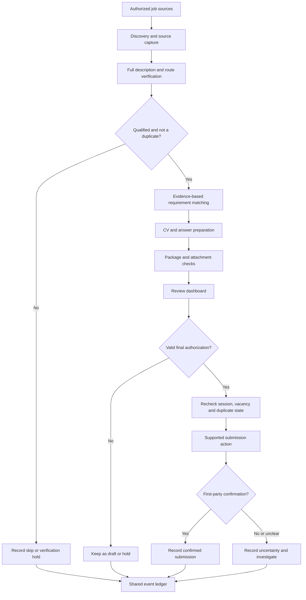

# Design and Workflow Specification

This document specifies proposed behavior for AI Job Apply. Implementation milestones and acceptance checks are in [ROADMAP.md](ROADMAP.md).

## What the system is intended to do

| Stage | Intended capability | Essential safeguard |
| --- | --- | --- |
| Discover | Search user-authorized job boards, employer postings, and recruitment email sources | Preserve source URL, date checked, and access limitations |
| Understand | Read the full job description and distinguish mandatory from preferred requirements | Never turn a partial snippet into a confirmed qualification |
| Evaluate | Match requirements to verified experience and configurable preferences | Explicit hard-requirement checks; do not invent experience |
| Deduplicate | Reconcile roles across discovery, email, and application channels | Check exact vacancy identity and prior evidence before proceeding |
| Prepare | Create role-relevant CVs, emails, and form-answer drafts | Source-backed claims; checked document version and attachment |
| Review | Show a job summary, required skills, proposed answers, and final documents | Separate shortlist interest from permission to submit |
| Apply | Execute only through a supported, authorized integration | Recheck account state, route, content, duplicates, and approval |
| Verify | Capture submission confirmation or a precise failure/uncertainty | A click or a saved draft is not proof of submission |
| Track | Maintain a shared event history and next actions | Never overwrite contradictory or uncertain history silently |

The project is designed around **an end-to-end process**, not a single prompt that blindly applies to jobs.

## Conceptual agent roles

These are **responsibility boundaries**, not a claim that independent AI agents or background workers are installed.

| Role | Responsibility | Does not do |
| --- | --- | --- |
| Coordinator | Shared policy, queue, source-of-truth records, authorization, deduplication, reporting | Invent approvals or application results |
| LinkedIn Discovery | Discover and evaluate relevant LinkedIn job listings; identify the actual application route | Submit applications or claim a live authenticated session |
| Email Opportunity Discovery | Verify hiring posts, employer contacts, and published application channels | Send unsolicited applications merely because an address exists |
| CV and Document Preparation | Build truthful, targeted, reviewable application documents from permitted evidence | Create false achievements, qualifications, or work history |
| LinkedIn Application | Prepare supported in-platform applications and submit when specifically authorized | Treat external websites as in-platform applications; bypass platform controls |
| Email Application | Prepare and, when authorized, send accurate applications using a verified recipient/thread | Guess email addresses or confuse drafts with sent messages |

One assistant may carry out several of these roles sequentially. Role separation is about quality control and clear ownership, not a promise of parallel execution.

## Intended end-to-end workflow



A planned dashboard, a proposed agent, and an application that actually ran are three different things. Each needs its own evidence and status.

## Job discovery and matching

### Discovery inputs

Potential inputs include job boards, LinkedIn listings, employer career pages, verified recruitment posts, and authorized email threads. A public search result may identify a lead, but **does not prove** a job is still open, that a user is signed in, or that an in-platform application is supported.

A candidate opportunity should preserve:

- Company, title, location, source URL, and any stable job or requisition ID.
- Date posted, if actually available; time last checked.
- Full requirements or a faithful summary retaining all material details.
- Mandatory versus preferred skills, responsibilities, and working conditions.
- Real application route: in-platform form, verified email, external portal, or unknown.
- Stated compensation, if any, without guessing unpublished amounts.
- Fit assessment, hard gaps, evidence gaps, and suggested next action.

### Fit logic

The matching engine should use **configurable** criteria: career interests, skills, location and relocation preferences, job level, compensation constraints, employment type, and excluded organizations. These settings belong in **private applicant configuration**, not in repository examples or public code.

- Use a configurable scoring rubric, supported by specific evidence.
- A confirmed unmet mandatory requirement must not be hidden by a high score.
- Transferable experience can be useful without creating a fictional job title.
- Distinguish **verified**, **supported but not displayed**, **not yet verified**, and **confirmed gap**.
- Missing salary information does not automatically mean the salary is unacceptable.
- Don't inflate result counts using closed jobs, reposts, or previously applied vacancies.

## Application documents and answers

The document workflow should:

1. Load only applicant information explicitly provided for this purpose.
2. Compare the actual job requirements with evidence for every significant claim.
3. Reuse an already checked CV if it is suitable, instead of rebuilding it unnecessarily.
4. Tailor the summary, ordering, and emphasis without modifying historical facts.
5. Produce a readable, text-selectable, ATS-conscious PDF where required.
6. Inspect the exact output for factual errors, clipped text, extraction problems, and irrelevant content.
7. Keep the application email or cover letter separate from the CV itself.
8. Assign an artifact ID and revision or checksum to the reviewed document.
9. Confirm that the **actual uploaded or attached file** matches the approved package.

Reusable form answers should be scoped. An answer about one employer, skill, date range, or declaration must not become a blanket answer to a different question. Unknown mandatory answers block only the affected application; optional unknowns may remain blank where the form permits.

Supporting portfolios can be attached when relevant and permitted, with clear provenance for demonstration, public, or synthetic projects. Sample work must never be described as verified paid employment.

## Human approval and submission rules

**Shortlisting is not submission authorization.** A user selecting **Yes**, saving a draft, or approving general document quality must not by itself trigger a final external action.

The proposed two-stage process is:

1. **Review decision:** `Yes / No / Modify` for whether a vacancy should continue through preparation.
2. **Final action approval:** explicit consent for the **exact vacancy, channel, final CV version, answers, and intended submission action**.

Before a supported submission, verify all of the following:

- The original vacancy remains available and the route is supported.
- The applicant session is authenticated through legitimate means.
- Employer exclusions and duplicate checks pass.
- Required form fields and declarations are complete and truthful.
- The exact document and final answers match the reviewed package.
- The approval is active, has the correct scope, and has not been invalidated by a material change.
- The action complies with provider terms and security restrictions.

**No approval = no send or submit.** Changes to material application content require re-review. A failed or uncertain submission must not trigger blind retries. Do not bypass CAPTCHAs, rate limits, security checks, or access controls.

## Shared application state and evidence

Use a single record per actual vacancy, with an append-only event history where practicable. A repost or channel change is not automatically a new opportunity.

| Workflow state | Meaning |
| --- | --- |
| `RESEARCHED` | Lead found; more checks may be needed |
| `ROUTED` | Verified handoff recorded to the appropriate workflow |
| `PREPARING` | Draft, answers, or documents are incomplete |
| `READY` | Complete application package prepared; final submission may still require authorization |
| `NEEDS_INPUT` | A required applicant answer or decision is missing |
| `NEEDS_VERIFICATION` | Source, claim, eligibility, or destination remains uncertain |
| `TECHNICAL_HOLD` | Authenticated access, UI, integration, or a security control prevents progress |
| `SUBMISSION_UNCERTAIN` | An action may have succeeded; confirm before retrying |
| `SENT` | The email provider confirms sending, not necessarily delivery |
| `SUBMITTED` | The application service confirms submission for this vacancy |
| `DELIVERY_FAILED` | A message has a confirmed delivery failure |
| `SUBMISSION_FAILED` | A submission has a confirmed failure |
| `SKIPPED` | Excluded, closed, unsuitable, or outside the authorized route |

`DUPLICATE` should be recorded as the **current review disposition** when the vacancy already has a verified application. It must not erase the original `SENT` or `SUBMITTED` evidence.

Employer outcomes such as `INTERVIEW`, `REJECTED`, `OFFER`, or `WITHDRAWN` are **separate** from submission workflow states. An employer rejection does not mean an application was never submitted.

### Minimal fictional record

```json
{
  "id": "demo-application-001",
  "source": "https://example.com/jobs/demo-001",
  "employer": "Example Organization",
  "role": "Example Support Coordinator",
  "location": "Example City",
  "route": "UNVERIFIED",
  "fit": {
    "score": null,
    "hard_requirements_checked": false
  },
  "workflow_status": "RESEARCHED",
  "review_decision": null,
  "final_authorization": null,
  "cv_artifact_id": null,
  "submission_confirmation": null,
  "last_verified_at": null
}
```

This is a **fictional schema illustration**, not a candidate record, a live job, or an implemented database specification.

## Planned dashboard

### Search view

The Search view is intended to show discovered vacancies, relevance, required skills, source links, compensation when actually published, exclusions, duplicate indicators, search freshness, and honest reasons for skips or holds.

### Apply view

The Apply view is intended to show each prepared package, answers, the actual CV preview/version, its state, and explicit actions such as **Yes**, **No**, **Modify**, **Approve final package**, **Submit**, and **Submit selected**. Controls must reflect permissions and readiness. A disabled control should explain the precise missing condition.

### Operational reliability

A visible button is not evidence that a backend action exists. The dashboard needs verified frontend-to-backend integration, authorization checks, persistence, error reporting, actual provider confirmation, and recovery after disconnection. Any state change should be reflected in the same shared ledger rather than separate, conflicting counters.

## Background discovery and integrations

Continuous search is a **possible future capability**, not a feature that comes with a README or an AI chat session. It requires a deployed service or authorized scheduler, supported data sources, persistent state, monitoring, and clear operating limits.

- Polling frequency and data freshness must be disclosed; do not market polling as literal instant updates.
- Provider APIs, authenticated browser actions, and email access should be used only when allowed by the user and provider.
- The system should degrade gracefully: research can be retained even when login or submission is unavailable.
- External-site applications, recruiter messages, and account/profile changes need separate permission scopes.
- No integration should imply access to a user's account until authorization and connection are verified.

## Privacy and security requirements

This project is intended to be **safe to describe publicly**, but real application data is private by default.

**Never commit or publish:**

- Real CVs, portfolios containing personal information, applicant profiles, names, contact information, identity documents, or signatures.
- Actual compensation, employment histories tied to an identifiable applicant, personal preferences, family details, or screening answers.
- Live job-application ledgers, inbox exports, messages, recruiter conversations, screenshots, or browser recordings containing personal information.
- Passwords, API keys, service-account files, session cookies, access tokens, backup codes, or authentication state.
- Internal prompt files or local notes containing real applicant data, even when their filenames look harmless.

### Secure implementation expectations

- Keep private applicant configuration outside Git and use the principle of least privilege.
- Separate public fictional fixtures from private data stores and production logs.
- Redact sensitive content from logs, screenshots, analytics, error reports, and exported files.
- Minimize what is sent to AI providers; disclose the destination, purpose, and retention implications before data transfer.
- Use scoped permissions for read, draft, approve, and external-submit operations.
- Encrypt sensitive data at rest and in transit in any future deployed service.
- Protect sessions with supported authentication, safe token handling, and expiry checks.
- Provide data deletion/export controls and an explicit retention policy before a production release.
- Test prompt-injection resistance: external job descriptions and emails are **untrusted content**, not system instructions.
- Review committed files, diffs, issue attachments, and commit metadata before making anything public.

`.gitignore` is a useful barrier for common local files, **not** a security boundary and not a way to erase secrets already committed. If sensitive material is ever committed, treat it as an exposure and follow an appropriate removal and credential-rotation process.

## Proposed components

The first implementation can use local storage and manual vacancy imports. Candidate components are:

- Discovery adapters for supported sources.
- Requirement matching and applicant-evidence assessment.
- Document drafting and artifact/attachment checks.
- Package-specific approvals and external application handling.
- An event ledger for evidence, duplicates, and recovery.
- A Search/Apply review interface and explicitly authorized provider integrations.

Private runtime data must remain outside source control. Add external integrations after the local approval and evidence model is verified. Installation and deployment instructions should describe components that actually exist and have been checked.
